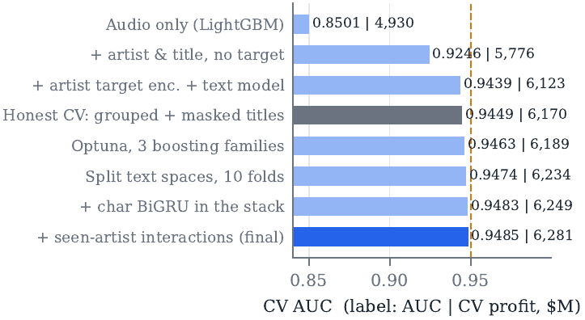

# Spot-a-hit: which songs should a label back?

Individual assignment for *Predictive Machine Learning in Finance* (IESE Master in Finance, November 2026). Given the
audio features, artist and title of 2,000 unreleased songs, decide which ones to invest in: a hit returns +1.5M and a
flop costs 0.9M, so the rule is to invest whenever P(hit) > 0.375. Training data: 10,000 labelled songs. No external
data allowed.

**Short answer: out-of-fold AUC 0.9485, accuracy 0.904 and 6,281M of profit on the 10,000 train songs, 86.6% of what
perfect foresight would earn.** Most of the gain came from reading the data before modelling it: the test titles are
masked (eleven lowercase letters replaced by `*`), the artist almost decides the label (83.5% of artists with two or
more songs are all hits or all flops), and the `id` only encodes the decade. The final model is a logistic stack of
three tuned gradient-boosting families, a character-level BiGRU and a TF-IDF text model. 61% of what the trees use comes
from who sings and what the song is called; the sound itself is under 20%. The two-page write-up is in the [report](report/QueipoDeLlano_Ignacio.pdf).



## Results (10-fold CV grouped by title, train titles masked like test)

| Run | What changed | AUC | Accuracy | Profit |
|---|---|---|---|---|
| 01 | LightGBM, audio only | 0.850 | 0.775 | 4,930M |
| 01 | + artist and title features, no target | 0.925 | 0.856 | 5,776M |
| 01 | + artist target encoding + text model | 0.944 | 0.893 | 6,123M |
| 07 | Honest baseline: grouped CV, masked train titles | 0.945 | 0.896 | 6,170M |
| 08 | Optuna (log-loss), LightGBM + CatBoost | 0.946 | 0.896 | 6,189M |
| 10 | Title and artist in separate text spaces, 10 folds | 0.947 | 0.901 | 6,234M |
| 13 | Stack: trees + char BiGRU | 0.948 | 0.903 | 6,249M |
| **13** | **+ text model and seen-artist interactions (submitted)** | **0.9485** | **0.904** | **6,281M** |

Investing in every song earns 2,602M; perfect foresight 7,251M. On test the model invests in 1,090 of 2,000 songs.

### Why 0.9485 is the limit within the rules

- **The curve went flat.** Adding the BiGRU to the trees is a small but real gain (+0.0011 ± 0.0005 AUC, paired
  bootstrap); every idea after that, such as nesting the BiGRU inside the trees, differs by 0.0003 ± 0.0006.
- **Capacity is not the bottleneck.** LightGBM, CatBoost and XGBoost score the same to the fourth decimal (0.9467).
- **What is left needs outside knowledge.** 21 hits get P < 0.05 (a Christmas song by Los del Río, PPAP) and 15 flops
  get P > 0.95. Run 17 measures it: a pretrained classifier (Jev) that never sees a label scores 0.925 on its own, and
  stacking it on top of this model reaches AUC 0.953 and 6,431M (+150 ± 20M). All of that gain is on artists the
  model has never seen (0.940 → 0.963): knowing who was famous is exactly what the rules leave out.

### Checks beyond the submitted model

| Run | Question | Answer |
|---|---|---|
| 15 | Random forest instead of boosting? | AUC 0.944, 6,146M: tuned boosting wins (0.947) |
| 16 | Label-free features fitted on train only, as in "fit on train only"? | costs 0.004 AUC and 51M: the unlabelled test songs still say how many songs an artist has and how they sound |
| 17 | How far does a model with outside knowledge go? | 0.953 and 6,431M, all of it on unseen artists; perfect foresight is 7,251M |

- The full reasoning, run by run and model by model, is in the [experiment diary](docs/DIARIO.md) (Spanish).

## Two ways to run it

Put `train.xlsx` and `test.xlsx` (course material, not included) next to the notebooks in `deliverable/`, then either:

| | What it does | Time |
|---|---|---|
| **Full** `QueipoDeLlano_Ignacio.ipynb` | the whole CRISP-DM pipeline: data checks, features, 10-fold CV of every model, evaluation, decisions; saves the fitted model to `spot_a_hit_model.joblib` | ~45 min (20 threads + GPU) |
| **Fast** `predict_from_saved_model.ipynb` | loads `spot_a_hit_model.joblib` (9 tree models, 5 BiGRUs, the stack), rebuilds the features and writes the same `decisions.csv` without training anything | ~2 min, with or without GPU |

The fast path checks itself: it prints the share of decisions identical to the full run that saved the model
(100%, probabilities within 1e-4 on GPU or CPU).

## Repository

```
deliverable/   the submitted notebook (CRISP-DM order, self-contained, runs in 45 min), its decisions.csv,
               the saved model (spot_a_hit_model.joblib) and the fast notebook that loads it
               build_notebook.py generates the notebook from code, so it never drifts from the experiments
src/           shared code: loading and title masking, features, CV pipeline, the BiGRU
experiments/   one script per run (run10 = run09 with K=10), the report figures and feature importance
results/       runs.csv (every CV score), best_params.json (Optuna), decisions.csv,
               jev_train.tsv (the pretrained classifier on the train songs, run 17 only)
report/        LaTeX source, figures and PDF of the two-page report
docs/          DIARIO.md, the experiment diary
```

## Reproduce

```bash
python -m venv .venv && . .venv/bin/activate
pip install -r requirements.txt
# put train.xlsx and test.xlsx in data/ (course material, not included)
python experiments/run13_final_stack.py   # needs the OOF files of runs 09 and 11 first
```

The BiGRU uses a CUDA GPU if there is one (the saved model also loads on CPU). Use all cores but two: with `n_jobs=-1`
LightGBM and CatBoost stalled on a 22-thread WSL machine.

Course materials and data are not included.
